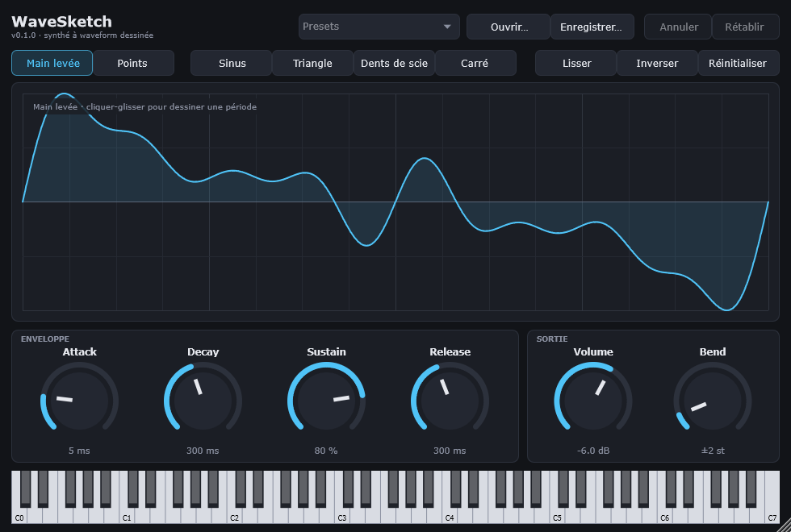

# WaveSketch

A **VST3** synthesizer for Windows (64-bit) whose sound comes from a waveform **drawn with the mouse**.
Designed for Ableton Live, usable in any VST3-compatible host, and also shipped as a standalone app
so you can try it without a DAW.



## Features

- **Draw one period** of the waveform, freehand (no gaps even when the mouse moves fast)
  or in **points mode** (points joined by a smooth curve; add / move / delete).
- One-click basic shapes (sine, triangle, sawtooth, square), **smooth**, **invert** (phase),
  **reset**, **undo / redo** (Ctrl+Z / Ctrl+Y).
- 14 built-in **presets**, **open / save** `.wavesketch` files.
- 2048-sample wavetable oscillator with Hermite interpolation, **16 voices** with voice stealing,
  velocity, pitch bend (adjustable range), sustain pedal.
- Per-voice **ADSR envelope** and master **volume**, all automatable in Ableton and smoothed to avoid clicks.
- **Anti-aliasing** with band-limited tables computed by FFT (one per octave), **DC removal**
  and level **normalisation**, without changing the drawing shown on screen.
- Editing the waveform while a note is playing causes **no clicks and no crashes** (20 ms crossfade).
- Everything is **saved in the Ableton project** (waveform, points, settings, window size).
- Dark, **resizable**, fully vector-based UI (stays sharp at 125 % and 150 % display scaling).

> Note: the UI, the manual test checklist and the installation guide are in French.

---

## 1. Requirements

| Tool | Version | Install (PowerShell) |
|---|---|---|
| Windows | 10 or 11, 64-bit | — |
| Git | any recent version | `winget install --id Git.Git -e` |
| CMake | 3.22 or later | `winget install --id Kitware.CMake -e` |
| Visual Studio 2022 **or** Build Tools 2022, with "Desktop development with C++" | 17.x | see below |

Build Tools 2022 (compiler only, without the Visual Studio IDE):

```powershell
winget install --id Microsoft.VisualStudio.2022.BuildTools -e --override "--passive --wait --add Microsoft.VisualStudio.Workload.VCTools --includeRecommended"
```

> Keep the installer window open until it finishes and accept the Windows permission prompt.
> JUCE does not need to be installed: it is downloaded automatically on the first build
> (an Internet connection is needed once).

## 2. Build

```bat
git clone https://github.com/EtienneMarec/WaveSketch.git
cd WaveSketch
build.bat
```

`build.bat` configures the project, builds it in **Release** mode and runs the automated tests.
It **does not copy anything** into `C:\Program Files`, so it does not need to run as administrator.

Output files:

| File | Path |
|---|---|
| VST3 plugin | `build\WaveSketch_artefacts\Release\VST3\WaveSketch.vst3` |
| Standalone app | `build\WaveSketch_artefacts\Release\Standalone\WaveSketch.exe` |
| Tests | `build\WaveSketchTests_artefacts\Release\WaveSketchTests.exe` |

<details>
<summary>Equivalent commands, without the script</summary>

```bat
cmake -S . -B build -G "Visual Studio 17 2022" -A x64
cmake --build build --config Release --parallel
ctest --test-dir build -C Release --output-on-failure
```
</details>

> ⚠ If the build fails with "LNK1104: cannot open file WaveSketch.vst3", another program
> (Ableton, pluginval) is using the plugin: close it and build again.

## 3. Install the plugin

A VST3 plugin is a **folder** named `WaveSketch.vst3`. Copy the **whole folder** into the system
VST3 folder:

```
C:\Program Files\Common Files\VST3
```

With File Explorer: copy and paste the folder, then accept the administrator permission prompt.
Or in a PowerShell window **run as administrator**:

```powershell
Copy-Item -Recurse -Force "build\WaveSketch_artefacts\Release\VST3\WaveSketch.vst3" "C:\Program Files\Common Files\VST3\"
```

> Close Ableton before replacing an older version of the plugin.

## 4. Make WaveSketch show up in Ableton Live

1. *Options → Preferences → Plug-Ins*.
2. Turn on **"Use VST3 Plug-In System Folders"**.
3. Click **"Rescan"** to scan the plugins again.
4. In the browser: *Plug-Ins → VST3 → WaveSketch Audio → WaveSketch*.
5. Drag WaveSketch onto a **MIDI track** and play some notes (MIDI keyboard, or press **M** in Ableton
   to use the computer keyboard).

The plugin does not show up? Check that the copied folder is named `WaveSketch.vst3` and contains
`Contents\x86_64-win\WaveSketch.vst3`, then run *Rescan* again (holding *Alt* while clicking forces a
full rescan).

## 5. Quick usage

| Action | How |
|---|---|
| Draw | **Main levée** (freehand) mode, click and drag in the central area |
| Points mode | **Points** button · click = add · drag = move · right-click or double-click = delete |
| Undo / redo | **Ctrl+Z** / **Ctrl+Y** (or Ctrl+Shift+Z), or the buttons in the top-right corner |
| Reset a knob to its default value | Double-click the knob |
| Type a value | Click the value shown under the knob, type it (`250 ms`, `1.5 s`, `-12`) and press Enter |
| Saved waveforms | `Documents\WaveSketch\*.wavesketch` by default |

## 6. Verify

- **Automated tests**: run by `build.bat` (wavetable, interpolation, mipmaps and measured aliasing,
  envelope, voices, drawing, points mode, state save / restore, undo).
- **pluginval** (plugin validation, maximum strictness level 10): download `pluginval_Windows.zip`
  from the [Tracktion/pluginval releases](https://github.com/Tracktion/pluginval/releases),
  extract `pluginval.exe` into `tools\pluginval\`, then run `validate.bat`.
- **UI screenshots** (100 %, 125 %, 150 % scaling) without a DAW:
  `build\WaveSketchTests_artefacts\Release\WaveSketchTests.exe --snapshots captures`
- **Manual tests** (listening, Ableton, display, distribution): see [TESTS_MANUELS.md](TESTS_MANUELS.md) (in French).

## 7. Share it with someone else

```bat
package.bat
```

Creates `dist\WaveSketch-<version>-win64.zip` with the plugin, the standalone app and an installation
guide ([packaging/INSTALLATION.txt](packaging/INSTALLATION.txt), in French).
The Microsoft C++ runtime is **linked statically**, so the recipient has nothing else to install.
The version number is set in `CMakeLists.txt` (`project(WaveSketch VERSION ...)`).

> Before distributing, check JUCE's licence terms (see *Licence* below).

## 8. Code layout

```
Source/
  PluginProcessor.*   plugin core: processBlock, parameters, state saving, undo
  PluginEditor.*      main window (buttons, knobs, virtual keyboard)
  Parameters.*        automatable parameters (IDs must never be renamed)
  dsp/                audio engine (no allocation and no locks on the audio thread)
    Wavetable.*         FFT band-limited tables, DC removal, normalisation, interpolation
    Voice.*, Envelope.h one voice: oscillator + ADSR + velocity
    SynthEngine.*       16 voices, MIDI, voice stealing, crossfade between waveforms
    TablePublisher.h    hands tables to the audio thread via an atomic exchange, never frees memory there
    WavetableBuilder.h  background thread that computes the tables
    WaveformOps.*, WaveShapes.*  strokes, smoothing, inversion, basic shapes
  model/              waveform state (mode, curve, points), serialisation, presets
  ui/                 drawing area and visual theme
Tests/                automated tests (+ screenshot tool)
packaging/            files added to the distribution archive
```

**How an edit travels:** the UI changes the waveform → a background thread computes the tables (FFT)
→ they are published through an atomic exchange → the audio thread picks them up on the next block
and crossfades from the old one over 20 ms. Old tables are handed back to the UI thread, which frees
them: the audio thread never frees memory.

## Licence

No licence has been chosen for this project yet: without a licence file, the code is visible
but all rights remain reserved by its author.

WaveSketch uses **JUCE**, which is dual-licensed: **AGPLv3** or the **commercial JUCE licence**
(see [juce.com/legal/juce-9-licence](https://juce.com/legal/juce-9-licence/) and
[JUCE's LICENSE.md](https://github.com/juce-framework/JUCE/blob/master/LICENSE.md)).
The licence chosen for WaveSketch must take this into account before any distribution.
